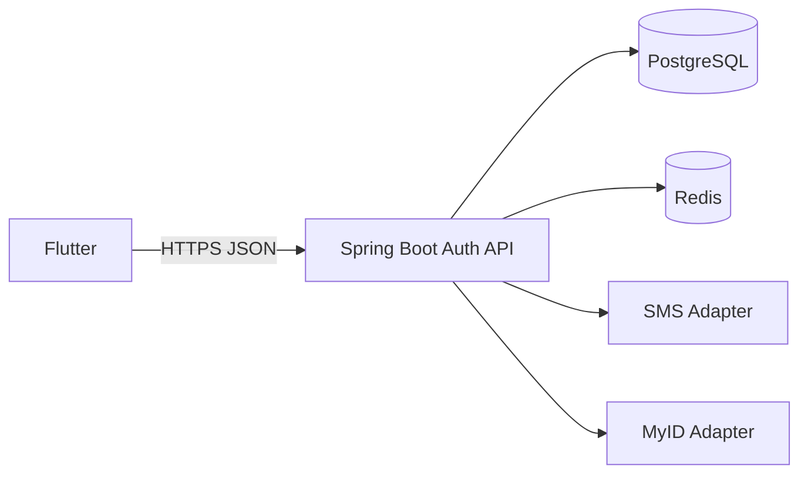

# CIB Mobile Auth

Production-oriented authentication starter for the CIB Flutter mobile application.

## Stack

- Java 21
- Spring Boot 3.5.x
- Maven
- PostgreSQL
- Redis + Lettuce, cluster-ready
- Flutter
- Flyway

## Implemented flows

```text
REGISTRATION
Phone → OTP → PINFL + Passport → Password → PIN → Session

LOGIN
Phone + Password
       ↓
Trusted device ──→ Session
New device ──────→ OTP → Trust device → Session
```

Authentication sessions use a signed JWT access token plus an opaque rotating refresh token.

SMS and identity verification are intentionally implemented as mock adapters until the real provider contracts are supplied.

## Architecture



The database controls versioned policy/UI configuration, **not arbitrary Java execution**.

See [Architecture](docs/ARCHITECTURE.md).

## Repository

```text
.
├── backend/                  Spring Boot auth service
├── flutter/                  Flutter auth client
├── docs/                     Architecture and runbooks
├── .github/workflows/        CI
├── docker-compose.yml        Local PostgreSQL/Redis/backend
├── .env.example              Development environment template
├── SECURITY.md
├── CONTRIBUTING.md
└── README.md
```

## Local start

```bash
docker compose up --build
```

Local services:

- API: `http://localhost:8080`
- PostgreSQL: `localhost:5432`
- Redis: `localhost:6379`

Health:

```bash
curl http://localhost:8080/actuator/health
```

Local mock behavior:

```text
OTP: 111111
SMS: static mock response
MyID: static verified response after local format validation
```

These mocks must not be used in production.

## Backend verification

```bash
cd backend
mvn clean verify
```

## Flutter

```bash
cd flutter
flutter create . --platforms=android,ios
flutter pub get
flutter analyze
flutter test
```

Android emulator:

```bash
flutter run --dart-define=API_BASE_URL=http://10.0.2.2:8080
```

## Documentation

- [Architecture](docs/ARCHITECTURE.md)
- [API](docs/API.md)
- [PostgreSQL data model](docs/DATABASE.md)
- [Redis design](docs/REDIS.md)
- [Security model](docs/SECURITY.md)
- [Local development](docs/LOCAL_DEVELOPMENT.md)
- [Operations](docs/OPERATIONS.md)
- [ADR-001: Dynamic auth boundary](docs/ADR-001-auth-boundary.md)
- [ADR-002: Storage boundary](docs/ADR-002-storage-boundary.md)
- [Verification report](VERIFICATION.md)

Interactive architecture documents from the design phase are also preserved in `docs/`.

## Important production boundaries

Before real banking deployment, complete at minimum:

- real SMS provider integration
- real identity-provider/MyID integration
- KMS/HSM-backed signing/pepper management
- device attestation/integrity integration
- gateway/WAF and organization rate-limit controls
- security review and penetration testing
- SAST/SCA/secret scanning
- privacy/data-retention review
- production observability/SIEM
- load/failover/disaster-recovery testing

The current repository is a production-oriented foundation, not a claim of production certification.
