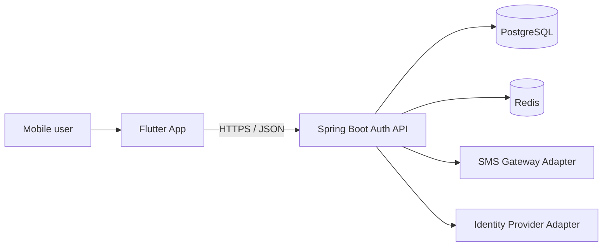
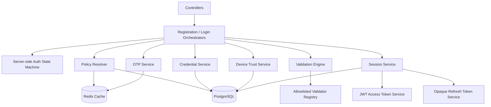
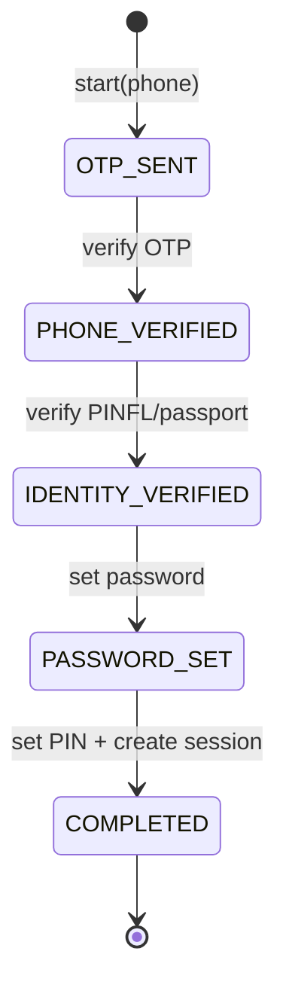
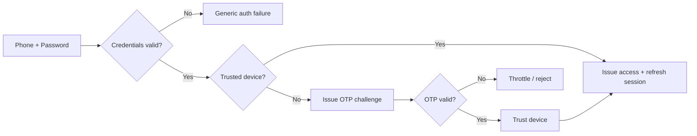
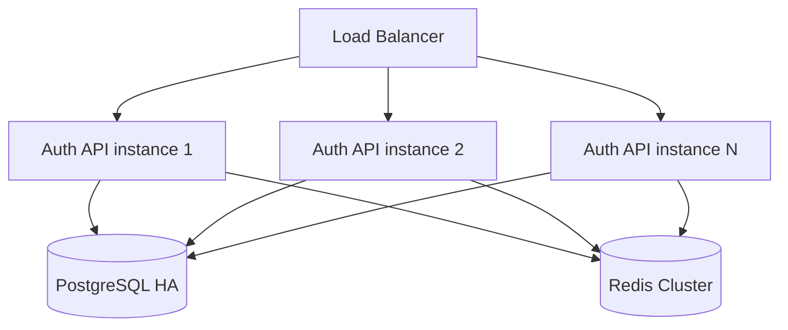

# CIB Mobile Auth — Architecture

## Scope

This repository implements the authentication boundary for the CIB mobile application.

Implemented flows:

- Registration: phone → OTP → PINFL/passport → password → PIN
- Login: phone + password
- New-device challenge: OTP before session issuance
- Access token + rotating opaque refresh token
- Dynamic/versioned auth policy and Flutter UI configuration
- Mock SMS and mock identity provider adapters

## System context



PostgreSQL is the durable source of truth. Redis stores ephemeral authentication state such as OTP challenges, registration flows, throttling state and cached policy.

## Backend layers



## Core design rule

The system is dynamic, but configuration cannot execute arbitrary backend code.

Bad:

```text
beanName = userService
methodName = deleteEverything
```

Allowed:

```text
validatorCode = PHONE_FORMAT
policyKey     = OTP_TTL_SECONDS
fieldType     = PHONE
```

Every executable capability is allowlisted in Java.

## Registration state machine



The client never owns the authoritative state. A direct call to a later endpoint is rejected if the server-side flow is not in the expected state.

## Login state machine



## Persistence boundary

### PostgreSQL

Durable state:

- users
- password/PIN hashes
- trusted devices
- refresh sessions
- audit
- versioned auth policy/UI configuration

### Redis

Ephemeral state:

- OTP challenges
- registration flow state
- new-device login challenge state
- login attempt counters
- rate limiting
- policy cache
- refresh-token reuse markers

## Package structure

```text
uz.cib.mobile
├── auth
│   ├── api
│   ├── application
│   ├── domain
│   ├── engine
│   ├── infra
│   ├── integration
│   ├── repository
│   └── security
├── common
└── config
```

## Dynamic vs static boundary

| Area | Dynamic / policy-driven | Static enforcement |
|---|---|---|
| OTP | length, TTL, resend delay, max attempts | secure generation, hashing, atomic consume |
| Password | minimum requirements | Argon2id hashing/verification |
| PIN | length/policy | pepper + Argon2id |
| Login | enabled methods, risk thresholds | authentication enforcement |
| UI | field order, labels, min app version | supported widget contract |
| Session | duration policy | refresh rotation and reuse detection |
| Device | trust duration | device binding verification |
| JWT | issuer/audience metadata | signing and signature verification |

## Deployment shape

Local development uses one PostgreSQL container and one Redis node.

Production target:



The API instances are stateless except for durable/ephemeral state in PostgreSQL and Redis.
