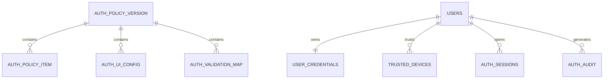

# PostgreSQL Data Model

Flyway owns the schema.

Migration location:

```text
backend/src/main/resources/db/migration/
```

## Tables

| Table | Responsibility |
|---|---|
| `auth_policy_version` | Version and publication lifecycle for dynamic auth configuration |
| `auth_policy_item` | Versioned auth policy values |
| `auth_ui_config` | Backend-driven Flutter auth UI configuration |
| `auth_validation_map` | Field → allowlisted validator mapping |
| `users` | User account identity/status |
| `user_credentials` | Password and PIN hashes |
| `trusted_devices` | Device trust records |
| `auth_sessions` | Refresh-session lifecycle |
| `auth_audit` | Security/audit events |

## Relationships



## Durable secret policy

The database must not contain:

- plaintext password
- plaintext PIN
- plaintext OTP
- plaintext refresh token
- raw server signing key
- raw application peppers

Persisted credential material is one-way transformed.

## Migration policy

1. Never edit an already-applied production migration.
2. Add a new Flyway migration for every schema change.
3. Schema changes must be backward-compatible during rolling deployments.
4. Destructive changes require an explicit multi-release migration plan.
5. Production configuration publication must use maker-checker/approval controls when the admin service is added.
